<picture>
  <source media="(max-width: 600px) and (prefers-color-scheme: dark) and (prefers-reduced-motion: reduce)" srcset="./assets/hero-mobile-dark-static.svg">
  <source media="(max-width: 600px) and (prefers-reduced-motion: reduce)" srcset="./assets/hero-mobile-light-static.svg">
  <source media="(prefers-color-scheme: dark) and (prefers-reduced-motion: reduce)" srcset="./assets/hero-dark-static.svg">
  <source media="(prefers-reduced-motion: reduce)" srcset="./assets/hero-light-static.svg">
  <source media="(max-width: 600px) and (prefers-color-scheme: dark)" srcset="./assets/hero-mobile-dark.svg">
  <source media="(max-width: 600px)" srcset="./assets/hero-mobile-light.svg">
  <source media="(prefers-color-scheme: dark)" srcset="./assets/hero-dark.svg">
  
</picture>

  <a href="#selected-work">Selected work</a> &nbsp; / &nbsp;
  <a href="#toolbox">Toolbox</a> &nbsp; / &nbsp;
  <a href="https://github.com/sriv144?tab=repositories">All repositories ↗</a>

**I build AI and data systems that do useful work.**

My projects connect models with the engineering around them: retrieval, APIs, data pipelines, simulation, and infrastructure. I’m drawn to problems where a clever idea has to become something understandable, testable, and useful.

Right now, that means exploring **agent workflows, reinforcement learning, and multi-robot systems**.

## Selected work

01 / FINANCIAL DOCUMENT INTELLIGENCE

### [FinLens ↗](https://github.com/sriv144/FinLens)

Turn SEC filings into answers with source retrieval, year-over-year comparisons, structured KPIs, and Excel exports.

`Python` `FastAPI` `Streamlit` `ChromaDB` `RAG`

02 / ROBOTICS & SIMULATION

### [Embodied Skill Composer ↗](https://github.com/sriv144/embodied-skill-composer)

A robotics research workbench for coordinating four robots through modular construction, with constraint-based scheduling and a browser digital twin.

`Python` `PyTorch` `OR-Tools` `React` `Three.js`

03 / QUANTITATIVE RESEARCH

### [AegisQuant ↗](https://github.com/sriv144/AegisQuant)

Benchmark-aware investment research and paper trading, with point-in-time data checks, execution gates, and audit trails.

`Python` `pandas` `PostgreSQL` `Alpaca` `Docker`

04 / AGENTS & INFRASTRUCTURE

### [KubeSentient ↗](https://github.com/sriv144/Autonomous-SRE-Agent)

An SRE agent that investigates Kubernetes alerts, retrieves relevant runbooks, and produces structured remediation plans.

`Python` `FastAPI` `LangGraph` `Weaviate` `Kubernetes`

More to explore: [data engineering experiments](https://github.com/sriv144/tds-iitm) · [RSA security analysis](https://github.com/sriv144/RSA-Vulnerability-Analyzer)

## How I approach a build

**Understand the problem → build a small working path → evaluate it → iterate.**

I care about the parts around the model as much as the model itself: clear interfaces, useful diagnostics, reproducible experiments, and a path from prototype to maintainable software.

## Toolbox

| Area | Tools I work with |
| :--- | :--- |
| Languages | Python · TypeScript · SQL |
| AI & research | PyTorch · LangGraph · RAG · sentence-transformers · PettingZoo |
| Interfaces & APIs | FastAPI · React · Three.js · Streamlit |
| Data & infrastructure | PostgreSQL · ChromaDB · Weaviate · Docker · Kubernetes · GitHub Actions |

## A little motion, powered by real commits

  
Play the contribution snake

   
  <picture>
    <source media="(prefers-color-scheme: dark) and (prefers-reduced-motion: reduce)" srcset="./assets/contributions-dark-static.svg">
    <source media="(prefers-reduced-motion: reduce)" srcset="./assets/contributions-light-static.svg">
    <source media="(prefers-color-scheme: dark)" srcset="./assets/contributions-dark.svg">
    
  </picture>
  
Generated from public contribution data. Refreshed daily with GitHub Actions.

---

**Let’s build something useful.** If one of these projects sparks an idea, [open a conversation in its issues](https://github.com/sriv144/FinLens/issues).

Curious about the code. Serious about making it work.

