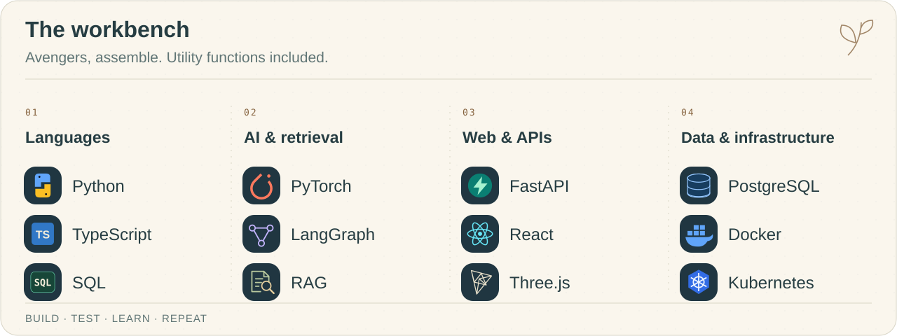

<picture>
  <source media="(prefers-reduced-motion: reduce)" srcset="./assets/cozy-header-static.svg">
  
</picture>

<b>Big Professor energy. Small, reviewable commits.</b> 
I’m Srivaths — building AI agents, data systems, and robots in simulation. 
Occasionally negotiating with a stubborn semicolon.

<a href="#a-tiny-arcade">Arcade</a> &nbsp; ✦ &nbsp; <a href="#toolbox">Toolbox</a> &nbsp; ✦ &nbsp; <a href="#current-side-quests">Side quests</a> &nbsp; ✦ &nbsp; <a href="https://github.com/sriv144">GitHub ↗</a>

## A tiny arcade

Winter is coming. Bring a warm drink and an extra life.

### 01 · Commit Cosmos

A little spacecraft patrols a sky built from my public contribution calendar. Every tile is a day; brighter stars mean more activity. Land a shot, watch a tile burn, then start another round.

<picture>
  <source media="(prefers-reduced-motion: reduce)" srcset="./assets/space-contributions-static.svg">
  
</picture>

### 02 · The contribution snake

Friends don’t lie. Neither does the contribution graph.

<picture>
  <source media="(prefers-color-scheme: dark) and (prefers-reduced-motion: reduce)" srcset="./assets/contributions-dark-static.svg">
  <source media="(prefers-reduced-motion: reduce)" srcset="./assets/contributions-light-static.svg">
  <source media="(prefers-color-scheme: dark)" srcset="./assets/contributions-dark.svg">
  
</picture>

Autoplay game scenes, refreshed daily from public contribution activity.

## Toolbox

<picture>
  <source media="(max-width: 600px) and (prefers-color-scheme: dark)" srcset="./assets/toolbox-mobile-dark.svg">
  <source media="(max-width: 600px)" srcset="./assets/toolbox-mobile-light.svg">
  <source media="(prefers-color-scheme: dark)" srcset="./assets/toolbox-dark.svg">
  
</picture>

## Current side quests

- **AI agents & retrieval** — connecting models to tools, useful context, and workflows.
- **Robotics & reinforcement learning** — simulation, robot coordination, and learning through experiments.
- **Data engineering** — turning messy inputs into reproducible pipelines and useful interfaces.
- **Financial intelligence** — document understanding, research tools, and risk-aware paper-trading experiments.
- **Cloud & reliability** — Kubernetes, observability, and making complex systems easier to investigate.
- **Security & cryptography** — understanding failure modes and how to prevent them.

---

<b>Challenge accepted. See you in the next commit.</b> 
<a href="https://github.com/sriv144?tab=repositories">Meet the supporting cast ↗</a>

